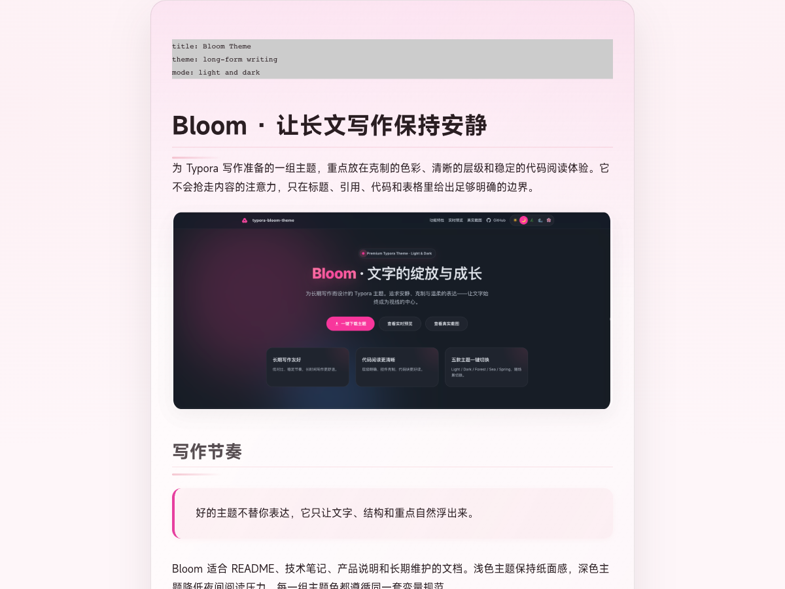
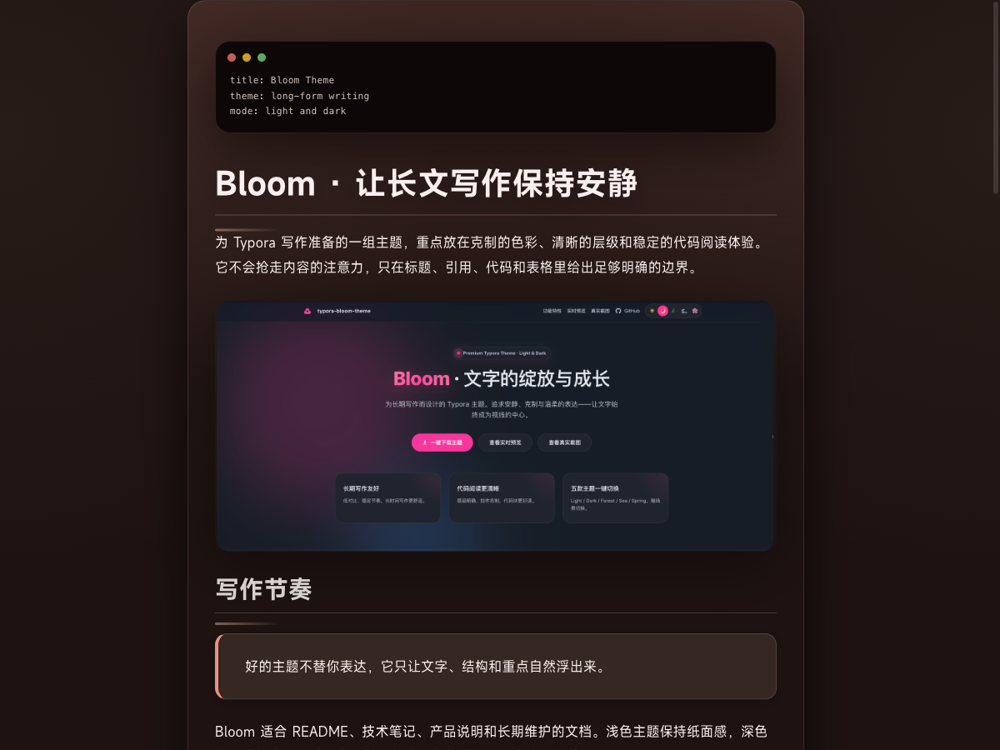
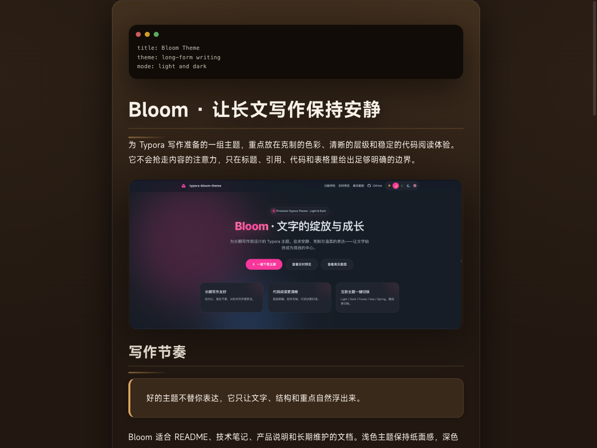
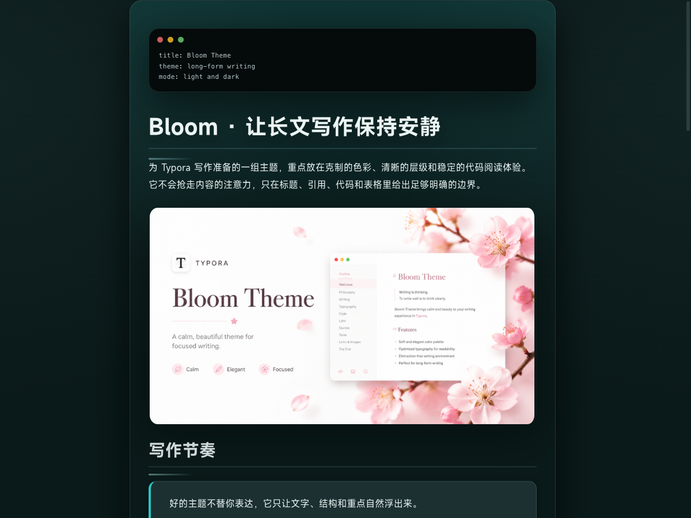
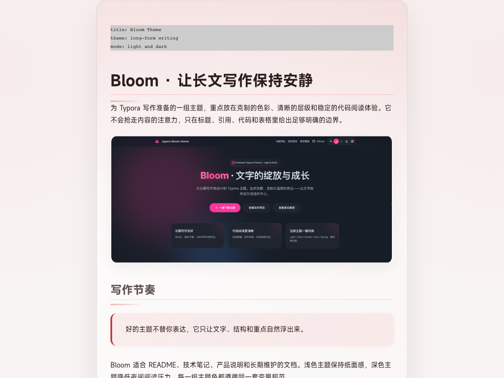
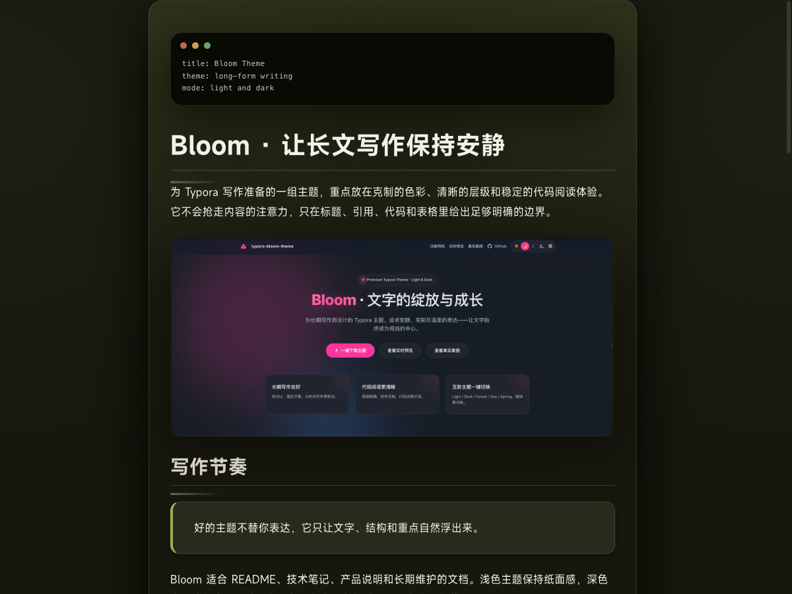

<!-- bloom-series-nav -->

<table align="center">
<tr>
<td align="center" width="33%"><b>🌸 Bloom for Typora</b><br/><sub>24 套主题 · 当前</sub></td>
<td align="center" width="33%"><a href="https://github.com/webkubor/dsh-bloom-theme">🌊 Bloom for DSH</a><br/><sub>4 套配色</sub></td>
<td align="center" width="33%"><a href="https://github.com/webkubor/contrast-guard">🛡️ contrast-guard</a><br/><sub>配色护栏</sub></td>
</tr>
</table>

<p align="center">
  <sub>同一套莫兰迪设计语言：两个宿主的主题，加一个守住它们配色的工具。<br/>
  <i>One Morandi design language — two themes, and the tool that keeps their colors honest.</i></sub>
</p>


<h1 align="center">Bloom for Typora</h1>

<p align="center">
  
  
  
  <a href="https://theme.typora.io/theme/Bloom/"></a>
  <a href="README.en.md"></a>
</p>

<p align="center">
  为长期写作准备的 Typora 主题。
  <br />
  更安静的页面，更稳定的层级，更统一的代码与文档视觉。
</p>

<p align="center">
  <a href="https://bloom.webkubor.online"><strong>预览官网</strong></a> ·
  <a href="https://github.com/webkubor/typora-Bloom-theme/releases/latest"><strong>下载最新版本</strong></a> ·
  <a href="https://github.com/webkubor/typora-Bloom-theme/issues/22"><strong>🗳️ 配色投票</strong></a>
</p>

## Bloom 是什么

Bloom 是一套面向长文写作的 Typora 主题集合，围绕三个核心目标打磨：

- 让正文更耐看，减少连续写作时的视觉疲劳。
- 让代码块、引用、表格、YAML Frontmatter 等高频模块风格统一。
- 让浅色和深色主题切换时，亮度与层次依然稳定。

当前版本为 `v1.3.5`。

## 为什么用 Bloom

| 特性 | 说明 |
| :-- | :-- |
| 24 套主题矩阵 | 12 套浅色和 12 套深色主题，覆盖温润、克制、自然、夜间等写作场景。 |
| OKLCH 调色 | 采用更接近人眼感知的色彩空间，减少主题切换时的亮度跳变。 |
| 统一模块语言 | 代码块、HTML Block、YAML Frontmatter、Alert 等模块共享同一套层级与圆角逻辑。 |
| 为 Typora 优化 | 针对 Markdown 编辑、预览阅读和深色模式对比度做过专门调整。 |

## 主题一览

12 套配色，每套都有浅色和深色（`-dark`）两个版本，共 24 个主题。

<table>
  <tr>
    <td align="center" width="50%">
      
      <sub><code>petal</code> 花瓣 · <code>petal-dark</code> 花瓣·暗夜</sub>
    </td>
    <td align="center" width="50%">
      
      <sub><code>mist</code> 雾蓝 · <code>mist-dark</code> 雾蓝·暗夜</sub>
    </td>
  </tr>
  <tr>
    <td align="center" width="50%">
      
      <sub><code>verdant</code> 草木 · <code>verdant-dark</code> 草木·暗夜</sub>
    </td>
    <td align="center" width="50%">
      
      <sub><code>stone</code> 暖石 · <code>stone-dark</code> 暖石·暗夜</sub>
    </td>
  </tr>
  <tr>
    <td align="center" width="50%">
      
      <sub><code>wheat</code> 麦穗 · <code>wheat-dark</code> 麦穗·暗夜</sub>
    </td>
    <td align="center" width="50%">
      
      <sub><code>ink</code> 水墨 · <code>ink-dark</code> 水墨·暗夜</sub>
    </td>
  </tr>
  <tr>
    <td align="center" width="50%">
      
      <sub><code>amber</code> 琥珀 · <code>amber-dark</code> 琥珀·暗夜</sub>
    </td>
    <td align="center" width="50%">
      
      <sub><code>lapis</code> 青金 · <code>lapis-dark</code> 青金·暗夜</sub>
    </td>
  </tr>
  <tr>
    <td align="center" width="50%">
      
      <sub><code>ripple</code> 涟漪 · <code>ripple-dark</code> 涟漪·暗夜</sub>
    </td>
    <td align="center" width="50%">
      
      <sub><code>cinnabar</code> 丹红 · <code>cinnabar-dark</code> 丹红·暗夜</sub>
    </td>
  </tr>
  <tr>
    <td align="center" width="50%">
      
      <sub><code>sage</code> 鼠尾草 · <code>sage-dark</code> 鼠尾草·暗夜</sub>
    </td>
    <td align="center" width="50%">
      
      <sub><code>spring</code> 紫语 · <code>spring-dark</code> 紫语·暗夜</sub>
    </td>
  </tr>
</table>

## 快速安装

1. 在 [Releases](https://github.com/webkubor/typora-Bloom-theme/releases/latest) 下载 `Bloom-theme.zip`。
2. 在 Typora 中打开 `偏好设置 -> 外观 -> 打开主题文件夹`。
3. 将压缩包中的所有 `bloom-*.css` 文件和 `bloom/` 文件夹复制到主题目录。
4. 重启 Typora，或从 `主题` 菜单切换到 Bloom。

## 本次版本更新

`v1.3.5` 主要包括：

- 新增麦穗 (Wheat) 浅色/深色主题。
- 修复深色模式标题栏、快速打开列表、源码模式对比度问题。
- 修复表格列宽拖拽 UI 错位。
- 开发工具链增强，统一发版流程。

完整更新日志见 [CHANGELOG.md](CHANGELOG.md)。

<details>
<summary>开发与构建</summary>

### 本地开发

```bash
pnpm install
npm run dev
```

`npm run dev` 会按 Typora 官方 toolkit 的方式准备本地浏览器预览：拉取 `typora/typora-theme-toolkit`，把当前主题 CSS 复制到 `html-preview/theme/test.css`，并打开 toolkit 的 HTML 预览页。指定主题：

```bash
npm run dev -- wheat-dark
```

### 常用命令

- `npm run build`: 重新生成 `dist/` 主题文件和站点主题数据。
- `npm run dev`: 使用官方 toolkit 路径进行本地浏览器预览与截图。
- `npm run dev:site`: 构建并打开官网展示页本地服务。
- `npm run sync:typora`: 构建后同步主题 CSS 和 `bloom/` 资源到 Typora 主题目录。
- `npm run dev:typora`: 监听主题源码变化，自动构建并同步到 Typora 主题目录。
- `npm run validate:themes`: 按 `mist` / `wheat` 标准校验主题变量与新增颜色定义。
- `npm run package`: 生成发布包 `Bloom-theme.zip`。

### Typora 实机调试

首次调试先在 Typora 中进入 `偏好设置 -> 外观 -> 打开主题文件夹`，确认主题目录存在。默认 macOS 目录为：

```bash
~/Library/Application Support/abnerworks.Typora/themes
```

然后在仓库中运行：

```bash
npm run dev:typora
```

修改 `theme-src/` 后脚本会自动构建并同步到 Typora 主题目录。Typora 未刷新时，切换到其他 Bloom 主题再切回来，或重启 Typora。需要检查具体 CSS 选择器时，在 Typora 中开启调试模式后用 DevTools 查看元素。

### 官方 toolkit 浏览器预览

浏览器预览只作为本地调试与截图手段，不随官网部署开放：

```bash
npm run dev -- petal
```

脚本会把生成后的 `dist/bloom-<theme>.css` 写入 `.cache/typora-theme-toolkit/html-preview/theme/test.css`，并复制 `bloom/` 资源目录。这个路径与 Typora 官方 toolkit 的推荐调试位置一致。

`wheat` / `wheat-dark` 这类生成型主题的颜色入口在 `scripts/theme-list.js`，构建时会自动生成主题 CSS 和站点主题数据，避免同时维护多份颜色值。主题颜色必须遵守 [Theme Color Standard](docs/theme-color-standard.md)。

### 仓库结构

- `theme-src/`: 主题源码，包含基础样式和各主题变量。
- `dist/`: 构建产物，Typora 实际使用的 CSS 文件。
- `bloom/`: 字体等静态资源。
- `scripts/`: 构建、打包和站点数据脚本。
- `website/`、`_pages/`: 展示站资源。

</details>

## 配套

Bloom 管**写字的环境**。内容本身怎么写 —— 结论先行、SCQA、MECE、语气姿态 —— 见 [talk-skills](https://github.com/webkubor/talk-skills)；写完要出 PDF 或长图，见 [facet](https://github.com/webkubor/facet)。三者互不重复定义：环境 / 方法 / 渲染。

## License

[MIT](LICENSE)

## Author

[webkubor](https://github.com/webkubor)


## 🌐 Web Resources & Aesthetic Symbols Index
- [SYM 2636](https://soft-bow-fonts-22.pages.dev/symbol/sym-2636/)
- [SYM 2610](https://sleek-dot-symbols-31.pages.dev/symbol/sym-2610/)
- [MUSIC FLAT SIGN](https://gothic-bio-fonts-81.pages.dev/symbol/music-flat-sign/)
- [SYM 1D470](https://alchemy-occult-symbols-55.pages.dev/symbol/sym-1d470/)
- [SYM 26C0](https://neon-matrix-symbols-94.pages.dev/symbol/sym-26c0/)
- [TRENDING](https://pastel-moe-emoticons-55.pages.dev/ru/trending/)
- [SYM 2671](https://synthwave-text-vault-95.pages.dev/symbol/sym-2671/)
- [SYM 26C7](https://aesthetic-spacing-fonts-10.pages.dev/symbol/sym-26c7/)
- [SYM 1F636 200D 1F32B FE0F](https://vintage-angel-text-38.pages.dev/symbol/sym-1f636-200d-1f32b-fe0f/)
- [CANCER ZODIAC CRAB](https://pastel-moe-emoticons-55.pages.dev/symbol/cancer-zodiac-crab/)
- [SYM 1D40C](https://gothic-bio-fonts-81.pages.dev/symbol/sym-1d40c/)
- [SYM 273C](https://cyber-clan-tags-36.pages.dev/symbol/sym-273c/)
- [SYM 1D44F](https://modern-bullet-symbols-45.pages.dev/symbol/sym-1d44f/)
- [SYM 26D3](https://gothic-bio-fonts-81.pages.dev/symbol/sym-26d3/)
- [SYM 2615](https://minimal-star-symbols-91.pages.dev/symbol/sym-2615/)
- [SYM 1F978](https://minimal-star-symbols-91.pages.dev/symbol/sym-1f978/)
- [SYM 1D443](https://mecha-gamer-fonts-53.pages.dev/symbol/sym-1d443/)
- [SYM 1D459](https://minimal-star-symbols-91.pages.dev/symbol/sym-1d459/)
- [HIGH VOLTAGE LIGHTNING](https://anime-sparkle-text-81.pages.dev/symbol/high-voltage-lightning/)
- [JA](https://alchemist-symbol-hub-29.pages.dev/ja/)
- [SYM 1D43D](https://minimal-star-symbols-91.pages.dev/symbol/sym-1d43d/)
- [SYM 1F602](https://pastel-moe-emoticons-55.pages.dev/symbol/sym-1f602/)
- [BRACKETS](https://sleek-line-unicode-29.pages.dev/ja/brackets/)
- [RU](https://anime-sparkle-text-81.pages.dev/ru/)
- [SYM 2683](https://minimal-star-symbols-43.pages.dev/symbol/sym-2683/)
- [SYM 1D411](https://sleek-line-unicode-29.pages.dev/symbol/sym-1d411/)
- [SYM 265A](https://daintystar-font-studio-48.pages.dev/symbol/sym-265a/)
- [SYM 26AB](https://sleek-line-unicode-29.pages.dev/symbol/sym-26ab/)
- [SYM 1D493](https://gothic-bio-fonts-81.pages.dev/symbol/sym-1d493/)
- [EIGHT POINTED BLACK STAR](https://kawaii-kaomoji-hub-77.pages.dev/symbol/eight-pointed-black-star/)
- [SYM 265B](https://kawaii-kaomoji-hub-77.pages.dev/symbol/sym-265b/)
- [SYM 1D412](https://minimal-star-symbols-91.pages.dev/symbol/sym-1d412/)
- [LATIN CROSS HEAVY](https://zen-unicode-symbols-89.pages.dev/symbol/latin-cross-heavy/)
- [SYM 1D48A](https://pearl-heart-symbols-95.pages.dev/symbol/sym-1d48a/)
- [SYM 260D](https://techno-hacker-text-43.pages.dev/symbol/sym-260d/)
- [SYM 26F4](https://minimal-star-symbols-91.pages.dev/symbol/sym-26f4/)
- [GOTHIC OBSIDIAN SKULL CREST](https://gothic-bio-fonts-81.pages.dev/symbol/gothic-obsidian-skull-crest/)
- [SYM 1F498](https://ribbon-bow-unicode-18.pages.dev/symbol/sym-1f498/)
- [SYM 26F8](https://sleek-line-unicode-29.pages.dev/symbol/sym-26f8/)
- [SYM 1F631](https://synthwave-text-vault-95.pages.dev/symbol/sym-1f631/)
- [SYM 1D43D](https://vintage-angel-text-38.pages.dev/symbol/sym-1d43d/)
- [RINGED PLANET SATURN](https://fairy-lace-symbols-92.pages.dev/symbol/ringed-planet-saturn/)
- [BRACKETS](https://daintystar-font-studio-48.pages.dev/es/brackets/)
- [SYM 2728](https://minimal-star-symbols-43.pages.dev/symbol/sym-2728/)
- [SYM 263A](https://pastel-moe-emoticons-55.pages.dev/symbol/sym-263a/)
- [SYM 1F494](https://occult-rune-symbols-64.pages.dev/symbol/sym-1f494/)
- [SYM 1D44C](https://vintage-angel-text-38.pages.dev/symbol/sym-1d44c/)
- [SYM 1D473](https://kawaii-kaomoji-hub-77.pages.dev/symbol/sym-1d473/)
- [SYM 1F638](https://vintage-angel-text-38.pages.dev/symbol/sym-1f638/)
- [SYM 1F92C](https://coquette-aesthetic-symbols-62.pages.dev/symbol/sym-1f92c/)
- [SYM 26B2](https://mecha-gamer-fonts-53.pages.dev/symbol/sym-26b2/)
- [SYM 26E2](https://synthwave-text-vault-95.pages.dev/symbol/sym-26e2/)
- [SYM 1D43C](https://mecha-gamer-fonts-53.pages.dev/symbol/sym-1d43c/)
- [SYM 1F978](https://angelic-ribbon-text-78.pages.dev/symbol/sym-1f978/)
- [BRACKETS](https://alchemist-symbol-hub-29.pages.dev/ru/brackets/)
- [SYM 1D464](https://gothic-bio-fonts-81.pages.dev/symbol/sym-1d464/)
- [SYM 263A FE0F](https://cyber-clan-tags-36.pages.dev/symbol/sym-263a-fe0f/)
- [SYM 2747](https://occult-rune-symbols-64.pages.dev/symbol/sym-2747/)
- [SYM 1D47E](https://coquette-aesthetic-symbols-62.pages.dev/symbol/sym-1d47e/)
- [SYM 260D](https://fairy-lace-symbols-92.pages.dev/symbol/sym-260d/)
- [SYM 26F5](https://sleek-line-unicode-29.pages.dev/symbol/sym-26f5/)
- [SYM 26A9](https://minimal-star-symbols-91.pages.dev/symbol/sym-26a9/)
- [SYM 2687](https://neon-matrix-symbols-94.pages.dev/symbol/sym-2687/)
- [FREEFIRE NAMES](https://minimal-star-symbols-91.pages.dev/es/freefire-names/)
- [SYM 1F601](https://kawaii-kaomoji-hub-77.pages.dev/symbol/sym-1f601/)
- [ZODIAC CELESTIAL](https://vintage-script-symbols-65.pages.dev/es/zodiac-celestial/)
- [SYM 1D496](https://daintystar-font-studio-48.pages.dev/symbol/sym-1d496/)
- [SYM 1D420](https://coquette-aesthetic-symbols-62.pages.dev/symbol/sym-1d420/)
- [SYM 26A3](https://pearl-heart-symbols-95.pages.dev/symbol/sym-26a3/)
- [SYM 2671](https://neon-matrix-symbols-94.pages.dev/symbol/sym-2671/)
- [SYM 1D427](https://sleek-dot-symbols-31.pages.dev/symbol/sym-1d427/)
- [SYM 1D427](https://zen-unicode-symbols-89.pages.dev/symbol/sym-1d427/)
- [SYM 2674](https://gothic-bio-fonts-61.pages.dev/symbol/sym-2674/)
- [SPRING TULIP BLOSSOM](https://aesthetic-spacing-fonts-10.pages.dev/symbol/spring-tulip-blossom/)
- [SYM 1F629](https://anime-sparkle-text-58.pages.dev/symbol/sym-1f629/)
- [SYM 1F47A](https://glitch-mecha-kaomoji-69.pages.dev/symbol/sym-1f47a/)
- [FREEFIRE NAMES](https://sleek-line-unicode-29.pages.dev/ru/freefire-names/)
- [GOTHIC BIO FONTS 61.PAGES.DEV](https://gothic-bio-fonts-61.pages.dev/)
- [LATIN CROSS HEAVY](https://dark-poetry-fonts-30.pages.dev/symbol/latin-cross-heavy/)
- [SYM 1F639](https://gothic-bio-fonts-61.pages.dev/symbol/sym-1f639/)
- [SYM 2611](https://pastel-moe-emoticons-55.pages.dev/symbol/sym-2611/)
- [SYM 26F6](https://coquette-aesthetic-symbols-62.pages.dev/symbol/sym-26f6/)
- [SYM 268A](https://pearl-heart-symbols-95.pages.dev/symbol/sym-268a/)
- [SYM 26CD](https://sleek-dot-symbols-31.pages.dev/symbol/sym-26cd/)
- [SYM 1F49E](https://kawaii-kaomoji-hub-89.pages.dev/symbol/sym-1f49e/)
- [SYM 1F915](https://gothic-bio-fonts-61.pages.dev/symbol/sym-1f915/)
- [SYM 2639](https://baroque-text-decor-84.pages.dev/symbol/sym-2639/)
- [FREEFIRE NAMES](https://angelic-bow-symbols-76.pages.dev/freefire-names/)
- [SWIMMING FISH RIGHT](https://dark-poetry-fonts-30.pages.dev/symbol/swimming-fish-right/)
- [SYM 2723](https://scholar-rune-symbols-77.pages.dev/symbol/sym-2723/)
- [OUTLINED STAR](https://sleek-line-unicode-29.pages.dev/symbol/outlined-star/)
- [SYM 1F92D](https://zen-unicode-symbols-89.pages.dev/symbol/sym-1f92d/)
- [SYM 2745](https://chibi-kaomoji-vault-58.pages.dev/symbol/sym-2745/)
- [SYM 26D5](https://kawaii-kaomoji-hub-77.pages.dev/symbol/sym-26d5/)
- [SYM 26D0](https://zen-unicode-symbols-89.pages.dev/symbol/sym-26d0/)
- [SYM 1D490](https://scholar-rune-symbols-77.pages.dev/symbol/sym-1d490/)
- [ROBLOX NAMES](https://soft-pastel-unicode-78.pages.dev/roblox-names/)
- [SYM 26C5](https://angelic-ribbon-text-78.pages.dev/symbol/sym-26c5/)
- [SYM 1D476](https://synthwave-text-vault-95.pages.dev/symbol/sym-1d476/)
- [TWELVE POINTED STAR](https://sleek-dot-symbols-31.pages.dev/symbol/twelve-pointed-star/)
- [ZODIAC CELESTIAL](https://sleek-dot-symbols-31.pages.dev/vi/zodiac-celestial/)
- [SYM 1D419](https://dark-poetry-fonts-30.pages.dev/symbol/sym-1d419/)
- [KAOMOJI](https://sleek-line-unicode-29.pages.dev/ru/kaomoji/)
- [SYM 1F611](https://vintage-angel-text-38.pages.dev/symbol/sym-1f611/)
- [HOLLOW STAR](https://dark-poetry-fonts-30.pages.dev/symbol/hollow-star/)
- [SYM 1D433](https://gothic-bio-fonts-81.pages.dev/symbol/sym-1d433/)
- [SYM 26CA](https://dark-poetry-fonts-30.pages.dev/symbol/sym-26ca/)
- [SYM 26FB](https://sleek-dot-symbols-31.pages.dev/symbol/sym-26fb/)
- [SYM 1D421](https://aesthetic-spacing-fonts-10.pages.dev/symbol/sym-1d421/)
- [SYM 267E](https://dark-poetry-fonts-30.pages.dev/symbol/sym-267e/)
- [WHITE HEART](https://dark-poetry-fonts-30.pages.dev/symbol/white-heart/)
- [SYM 26A4](https://dark-poetry-fonts-30.pages.dev/symbol/sym-26a4/)
- [SYM 26CC](https://sleek-line-unicode-29.pages.dev/symbol/sym-26cc/)
- [GEMINI ZODIAC TWINS](https://gothic-bio-fonts-61.pages.dev/symbol/gemini-zodiac-twins/)
- [SYM 26AA](https://minimal-star-symbols-91.pages.dev/symbol/sym-26aa/)
- [SYM 1D49F](https://kawaii-kaomoji-hub-89.pages.dev/symbol/sym-1d49f/)
- [SYM 1F641](https://anime-sparkle-text-58.pages.dev/symbol/sym-1f641/)
- [SYM 2626](https://sleek-dot-symbols-31.pages.dev/symbol/sym-2626/)
- [SYM 1D478](https://pastel-moe-emoticons-55.pages.dev/symbol/sym-1d478/)
- [SYM 1D46E](https://coquette-aesthetic-symbols-96.pages.dev/symbol/sym-1d46e/)
- [SYM 1D484](https://soft-pastel-unicode-78.pages.dev/symbol/sym-1d484/)
- [SYM 1F642 200D 2195 FE0F](https://scholar-rune-symbols-77.pages.dev/symbol/sym-1f642-200d-2195-fe0f/)
- [SYM 2656](https://soft-pastel-unicode-78.pages.dev/symbol/sym-2656/)
- [SYM 26AC](https://sleek-dot-symbols-31.pages.dev/symbol/sym-26ac/)
- [SYM 26B4](https://sleek-dot-symbols-31.pages.dev/symbol/sym-26b4/)
- [SYM 1D417](https://occult-rune-symbols-64.pages.dev/symbol/sym-1d417/)
- [SYM 1D47A](https://vintage-script-symbols-65.pages.dev/symbol/sym-1d47a/)
- [CROSSED SWORDS](https://sleek-dot-symbols-31.pages.dev/symbol/crossed-swords/)
- [SYM 1F61F](https://baroque-text-decor-84.pages.dev/symbol/sym-1f61f/)
- [SYM 1D497](https://techwear-bio-symbols-45.pages.dev/symbol/sym-1d497/)
